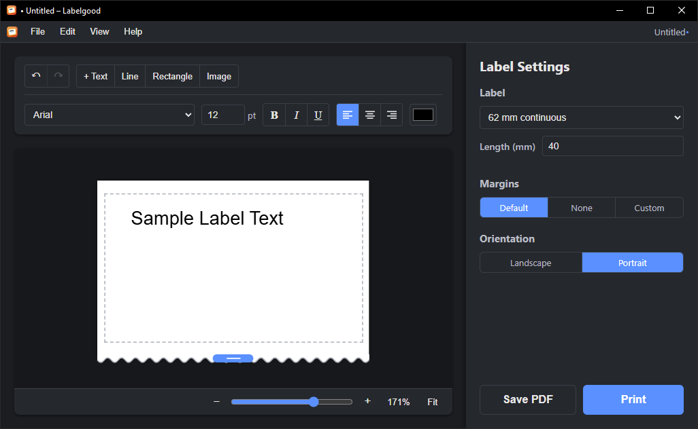

#  Labelgood

A label editor for label printers such as the Brother QL series. Design labels with text, lines, rectangles and images, then print them directly or save them as PDF. Runs on Windows and Linux.



## Installation

### Windows

- Installer: [x64](https://github.com/NotCoffee418/Labelgood/releases/latest/download/Labelgood-setup-x64.exe) · [ARM64](https://github.com/NotCoffee418/Labelgood/releases/latest/download/Labelgood-setup-arm64.exe)
- Or in PowerShell:
  ```powershell
  irm https://raw.githubusercontent.com/NotCoffee418/Labelgood/main/install.ps1 | iex
  ```

### Linux

- Debian/Ubuntu: [x64](https://github.com/NotCoffee418/Labelgood/releases/latest/download/Labelgood-amd64.deb) · [ARM64](https://github.com/NotCoffee418/Labelgood/releases/latest/download/Labelgood-arm64.deb)
- Fedora/openSUSE: [x64](https://github.com/NotCoffee418/Labelgood/releases/latest/download/Labelgood-amd64.rpm) · [ARM64](https://github.com/NotCoffee418/Labelgood/releases/latest/download/Labelgood-arm64.rpm)
- AppImage: [x64](https://github.com/NotCoffee418/Labelgood/releases/latest/download/Labelgood-amd64.AppImage) · [ARM64](https://github.com/NotCoffee418/Labelgood/releases/latest/download/Labelgood-arm64.AppImage)
- Or any distro:
  ```bash
  curl -fsSL https://raw.githubusercontent.com/NotCoffee418/Labelgood/main/install.sh | bash
  ```

MSI, portable builds and checksums are on the [releases page](https://github.com/NotCoffee418/Labelgood/releases/latest).

## Printing

Labelgood prints through the system's own printer drivers, so no extra tools are needed:

- **Windows**: any installed printer. Options such as cutting come from the driver's own settings.
- **Linux**: CUPS. Use the permanent queue for your printer (e.g. `QL-810W`); temporary auto-discovered queues don't report their options.

The print dialog shows whatever options the selected printer's driver offers (cutting, quality, media type, …) and remembers your choices per printer.

## Development

### Prerequisites

- [Node.js](https://nodejs.org/) (v24 LTS or later)
- [Rust](https://www.rust-lang.org/) (latest stable)
- System dependencies for Tauri (see [Tauri Prerequisites](https://tauri.app/start/prerequisites/))

### Getting Started

```bash
npm install          # install dependencies
npm run tauri dev    # run the app in development mode
npm run tauri build  # build the app and its installers/packages
```

### Project Structure

- `src/` - Svelte frontend
  - `routes/+page.svelte` - the app's single page, composed from the components below
  - `lib/components/` - UI components (toolbar, canvas, settings panel, print dialog, ...)
  - `lib/state/` - shared state (runes in `.svelte.ts` modules) and the editor's behaviour: elements, undo, mouse gestures, keyboard shortcuts, clipboard, printing, settings
  - `lib/` - helpers without app state: types, label formats, rich text editing, rendering for print, and typed wrappers for the Rust commands
- `src-tauri/` - Rust backend (printing, PDF generation, fonts)
- `static/` - Static assets
- `.vscode/` - Editor settings and recommended extensions

Recommended editor: [VS Code](https://code.visualstudio.com/) with the [Svelte](https://marketplace.visualstudio.com/items?itemName=svelte.svelte-vscode), [Tauri](https://marketplace.visualstudio.com/items?itemName=tauri-apps.tauri-vscode) and [rust-analyzer](https://marketplace.visualstudio.com/items?itemName=rust-lang.rust-analyzer) extensions.

## Release Workflow

Pushing a version tag builds and publishes a release:

```bash
git tag v1.0.0
git push origin v1.0.0
```

Tags must be plain `vMAJOR.MINOR.PATCH`; the packages take their version from the tag.

The workflow runs the tests, then builds with Tauri's bundler:

- **Windows** (x64 and ARM64): installer, MSI and portable executable
- **Linux** (x86_64 and ARM64): `.deb`, `.rpm`, AppImage and plain binary

and creates a GitHub release for the tag with all of them. Linux ARM64 is built natively on GitHub's ARM runners; Windows ARM64 is cross-compiled on x64 Windows.
